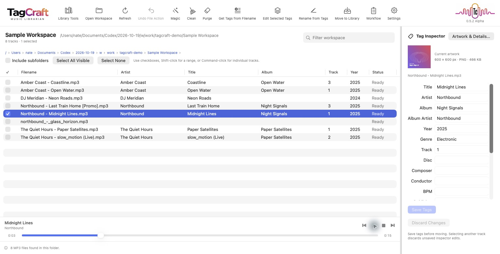
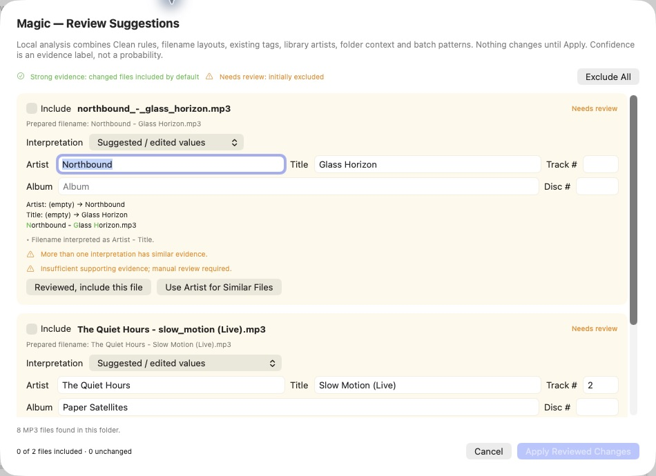
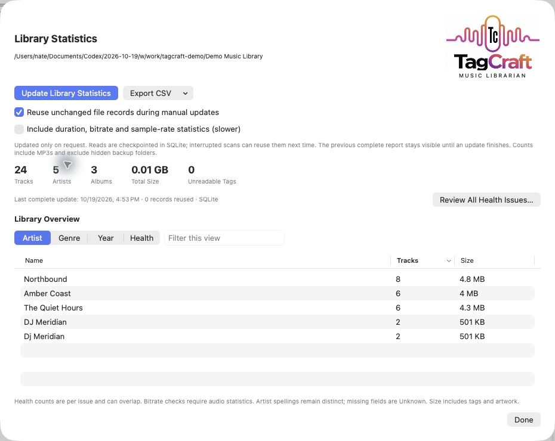
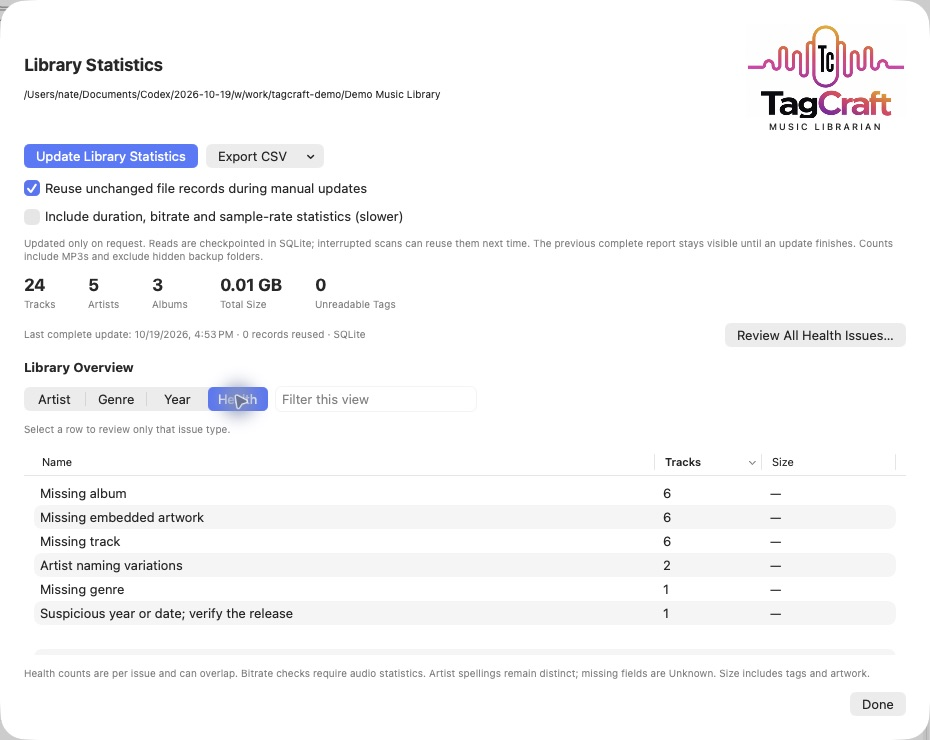
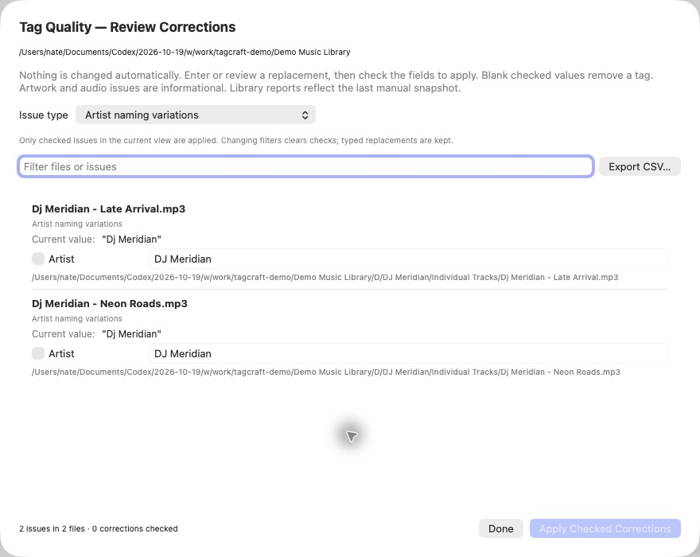
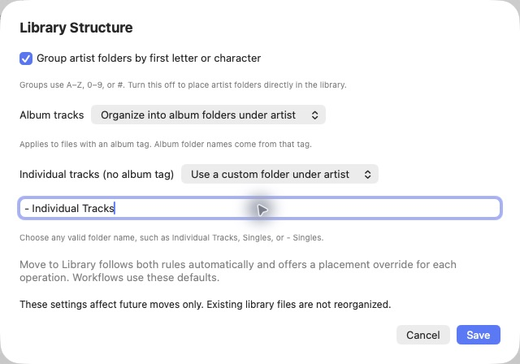
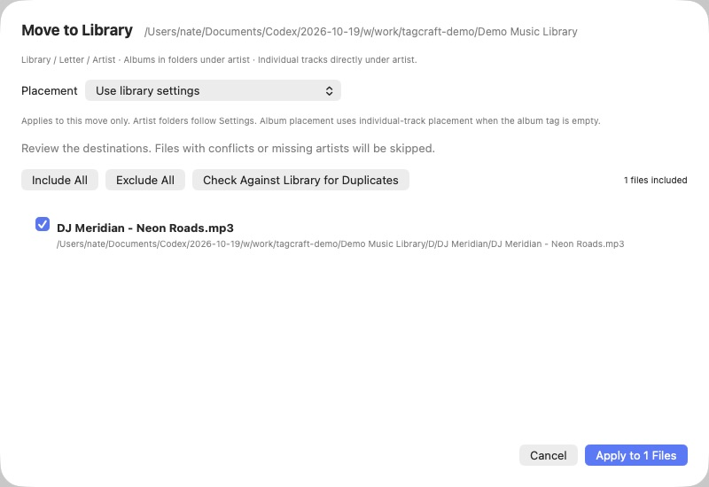

# TagCraft Music Librarian · Alpha


**Edit music tags, clean filenames, and organize your library.**

TagCraft is a macOS music-tag editor and library organizer, currently supporting **MP3 files**. Edit tags individually or in batches, extract artist, title, album, and other fields from a filename’s structure, or rename files using their saved tags. An **integrated workspace music player** lets you listen while reviewing files and metadata.

**Magic** brings filename cleanup, tag interpretation, and renaming together in one reviewable operation. It uses your Clean rules, spelling exceptions, existing tags, and local context to suggest changes. Review alternatives, edit suggestions, and choose which files to include before applying.

Use **Clean** to normalize filename spacing, punctuation, capitalization, and unwanted labels. Use **Purge** to remove selected tag fields or embedded content. Each remains available separately when you want more control.

**Move to Library** organizes files from your working folder into a separate **primary music library—the home for your entire music collection**. Choose its folder structure, including optional first-letter grouping, album folders under artists, and custom folders for individual tracks. Preview destinations before moving prepared files into that collection.

**Library Statistics and Health** scans your **entire primary music library**, independently of the current working folder. Explore collection-wide track counts, storage totals, and artist, genre, and year summaries. Find missing or suspicious tags, naming variations, inconsistent album artists, and other issues, then review selected corrections. Local SQLite caching lets subsequent scans reuse unchanged file records.

Requires **macOS 14 or later**. Processing and analysis run locally; no online metadata lookup is required. Current alpha: **0.6.0 Alpha, build 54**.

## Development disclaimer

TagCraft was developed using **OpenAI Codex**, with human direction and review. AI-assisted development and automated tests do not guarantee error-free behavior. This is alpha software; test changes on disposable copies with independent backups before using write operations on an original music library.

## Download and install

[**Download macOS Alpha 0.6.0 (Apple silicon)**](https://github.com/natsteff/TagCraft/releases/download/v0.6.0-alpha/TagCraft-0.6.0-alpha-macOS-arm64.dmg) · [All releases](https://github.com/natsteff/TagCraft/releases) · [Installation](#installation)

**Experimental alpha download.** Requires macOS 14 or later on an Apple silicon Mac (M1 or newer). This release does not include an Intel build. Choose the packaged `.dmg` release asset rather than GitHub’s source-code archives. Test write operations on disposable copies; see the safety limitations below.

### Installation

1. Download the TagCraft `.dmg` from the release page.
2. Open it and drag **TagCraft Music Librarian** into **Applications**.
3. Eject the disk image, then open TagCraft from Applications.
4. The preview is not notarized. If macOS blocks it, follow [Apple’s instructions for opening an app from an unidentified developer](https://support.apple.com/en-us/102445), including **System Settings → Privacy & Security → Open Anyway**, when available.

To update, quit TagCraft and replace the app in Applications with the newer copy. Settings and the statistics database are stored separately from the application.

## Preview status and known limitations

**This is an experimental preview. Use disposable copies when testing edits, artwork changes, purges, renames, or moves. It is not ready for writes to an original music library.**

The remaining confirmed write-safety issues concern malformed ID3 boundaries, preservation of undecodable text tags, and stale metadata overwriting newer changes. They can affect a single file as well as a batch. Backups reduce recovery effort but do not guarantee safe writes.

Risk depends on the action:

- **Read-only music operations:** opening folders, browsing tags, playback, statistics scans, Health analysis, duplicate checks, and previews do not intentionally modify music files. They may save local settings, caches, and reports separately.
- **Tag and artwork changes:** saving tags, replacing/removing artwork, applying Health corrections, purging, and Magic/workflow tag writes use the shared writer and are affected by the unresolved issues above. Health corrections check edited fields against their report values, but still use that writer.
- **Moves and renames:** previews help confirm intended destinations and names, and detected conflicts are refused. Recovery is limited if an operation is interrupted. Workflows that also edit tags carry the tag-write risks.

Previews help catch unwanted suggestions or intended changes. They cannot reveal hidden audio truncation, unrelated tag loss, or stale values overwriting newer metadata. Review alone does not resolve those implementation defects.

Symbolic-link files and folders are skipped during discovery. Linked roots or destination paths are refused; file jobs check source, destination, and backup paths again before mutation. Workspace/statistics scans report skipped links. Standard macOS `/var`, `/tmp`, and `/etc` aliases are allowed. This addresses the reproduced linked-folder redirection; the checks are not a filesystem lock against another process changing paths concurrently.

Settings, reports, and caches are stored locally. No online metadata service is used.

Other limitations:

- MP3 only; the tag editor supports standard ID3v2.3/v2.4. Unsupported formats or flags are rejected where detected. Legacy ID3v1 fields are not imported into the general inspector.
- A workspace filter does not clear selected files hidden by that filter. Review the operation's file list before applying.
- Cancellation stops remaining work; it does not undo completed files.
- Undo covers the latest move/rename operation in the current session. Tag recovery is manual from backups.
- The app is locally ad-hoc signed, not notarized. Full live UI and audible-playback verification remains incomplete.

## Run and build

Open **TagCraft Music Librarian.app** beside this source folder if using the locally packaged build. To build from source, use a macOS Swift toolchain compatible with Swift tools 5.9 or later and the macOS 14 SDK or later:

```sh
./build-app.sh
```

The script builds a release executable, packages the icon and logo, and applies a local ad-hoc signature. SQLite uses the system library; no database server is required. The bundle identifier is `local.tagcraft.musiclibrarian`.

## Screenshots

<details>
<summary>Show screenshots — workspace, Magic, library statistics, Health and organization</summary>

Actual captures of **0.5.2 Alpha, build 52**, using fictional artists and original sample artwork. The sample workspace contains eight files; the separate demo library contains 24 tracks. No changes were applied from preview or correction dialogs. The library-structure example is an unsaved draft, discarded after capture.

The workspace combines a sortable file list, tag inspector, embedded artwork, and integrated music player.



### Magic — review cleanup, tag interpretation and rename suggestions

Ambiguous interpretations remain excluded until reviewed. Suggested tags and filename changes are shown together.




### Primary library — statistics and Health

Statistics cover the separate primary library, with cached records and artist, genre, year and Health views.



Select a Health row to review only that issue type.



Corrections show current values and suggested replacements. This example respects the Clean Rules spelling exception for DJ; nothing is checked or applied.




### Library structure and Move to Library preview

Album and individual-track placement are configured independently. Settings are committed only with Save.



Move to Library previews the destination and offers a placement override for that operation.



</details>

## Workspace and playback

Open a workspace folder to list its directly contained MP3 files. **Include subfolders** enables recursive listing and starts off each launch. The last workspace and recent folders are remembered. Refresh updates the listing; optional Automatic Refresh is available in Settings.

Select files using checkboxes, Select All Visible/None, Shift-click, or Command-click. Column headers sort the list. The workspace filter is always available beside the folder heading. A resizable Tag Inspector shows the selected file's tags and embedded-artwork preview.

The mini player provides Previous, Play/Pause, Stop, Next, and seeking. Its queue follows the filtered and sorted workspace list independently of the edit selection. File details and completion messages appear at the lower left; active progress and cancellation appear at the lower right.

The action bar supports Icons and Text or Icons Only. Actions that do not fit move into **More**. A single decorative waveform with the version and Alpha label appears at the far right when space permits. **Settings → About TagCraft…** (also in the application menu) always provides the version, build, release channel, and a GitHub link. A short launch splash displays the full logo and shared version label; the empty-workspace welcome view also uses the full logo. Clicking the top-left wordmark opens the [TagCraft GitHub project](https://github.com/natsteff/TagCraft).

## Tags and artwork

The inspector edits 19 fields: title, artist, album, album artist, year, genre, track, disc, composer, conductor, BPM, publisher, copyright, encoded by, language, grouping, subtitle, ISRC, and lyricist.

**Edit Selected Tags** lets you choose files and fields independently. Shared values appear normally; differing values show **Multiple values**. **Common Fields** selects shared fields. Checked fields replace existing values; a checked blank value clears that field. Save inspector edits before starting another action; selecting another track discards unsaved inspector edits.

Embedded artwork is visible in the inspector and batch editor. **Artwork & Details…** lists pictures, dimensions, formats, and sizes. Export a picture, choose or drop JPEG/PNG artwork, optionally downscale it, resize an existing front cover, or explicitly remove all artwork. Replacing a front cover is designed to retain other picture types unless **Replace all embedded pictures** is selected; the write-safety limitations above still apply.

## Filename tools and Magic

- **Clean** prepares raw filenames using configurable punctuation, spacing, capitalization, spelling exceptions, and removable labels. It does not read or change tags or reorder fields.
- **Get Tags from Filename** extracts fields with a preset or custom mask such as `{Artist} - {Title}`. Only fields named in the mask are replaced. `{Skip}` matches content without saving it. The extension is excluded. Masks and separators are literal; optional delimiter handling supports nested brackets. Yellow warnings remain eligible for Apply and need review.
- **Rename from Tags** creates filenames from saved tags with presets or a custom mask. It preserves tag capitalization and adds `.mp3`. Missing values and detected filename conflicts are skipped. Files remain in their folders.
- **Magic** combines Clean rules, filename interpretation, existing tags, library artist names, batch evidence, and conservative folder context into editable suggestions. Review artist, title, album, track, disc, alternative interpretations, and the proposed filename before applying. Uncertain files initially remain excluded; unchanged files are excluded as **No change needed**. Magic does not move files or purge tags.
- **Workflow** configures saved combinations of clean, extract, purge, rename, and move steps. Its preview identifies actual changes and excludes no-op files.

## Library structure and moving files

Choose or change the library root under Settings. The chooser shows the selectable, scrollable current location; the full path also appears in Library Statistics. **Settings → Library Structure** has independent rules for:

- Optional first-letter grouping above artist folders: A–Z, 0–9, or #.
- **Album tracks:** organize into album folders under artist, or place directly under artist. The album tag supplies the folder name.
- **Individual tracks (no album tag):** place directly under artist, or in a custom folder under artist.

**Custom individual tracks folder name** accepts any valid folder name, including `Individual Tracks`, `Singles`, or `- Singles`. Settings use a draft: **Save** commits changes and **Cancel** discards them. Existing installations retain letter/artist/file placement until changed. Settings affect future moves; existing files are not automatically reorganized.

**Move to Library** follows these rules by default and previews destination paths. Placement can be overridden for that operation: use album folders, individual-track placement, or directly under artist. First-letter grouping always follows Settings. Workflow moves use the saved rules. Examples:

```text
Library/A/Artist/Album/Track.mp3
Library/Artist/Album/Track.mp3
Library/Artist/- Singles/Track.mp3
Library/Artist/Track.mp3
```

Artist, rather than album artist, determines the artist folder. Accents fold to the base sorting letter; leading “The” is retained. Moves preserve filenames. Missing artists and detected destination conflicts are skipped; overwrites are refused by the operation checks. Existing library names can be offered as artist suggestions.

## Purge, backups, and recovery

**Settings → Tags to Purge…** chooses text fields, artwork, comments, lyrics, ratings/play counts, and custom text/URL fields. Purge previews affected fields and removes selected frame types, including corresponding legacy ID3v1 values.

Tag writes, artwork changes, and purges create unique full-file backups in `.TagCraft Backups` beside the source. Restore a backup manually through Finder. Pure moves and renames do not make a second full copy. These backups share the source storage and are not a substitute for an independent library backup.

## Library statistics and health

Statistics updates are manual. Counts include MP3 files; hidden backup folders and symbolic links are excluded. Overview tabs group by Artist, Genre, Year, and Health, with optional Bitrate and Sample Rate groups when audio details have been collected. Tabs initially sort by descending count; **Unknown** has no special pinned position.

Each update discovers current files, then reuses records whose path, size, and modification date match when **Reuse unchanged file records** is enabled. Deleted files disappear from the next completed report; unreadable records are retried. Disable reuse to reread everything. Optional duration, bitrate, and sample-rate analysis takes additional work.

During discovery, progress shows files found and elapsed time with a message that processing rate and estimated time are being calculated. Processing then shows completed/total tracks, reused records, average tracks/sec, elapsed time, and approximate time remaining. Times use `H:MM:SS`; large counts use comma separators. Estimates can change substantially as processing progresses.

Select a Health row to open only that issue type. **Review All Health Issues…** opens the full report. Issue-type and text filters narrow corrections; changing filters clears checked selections. Only checked findings still in the current view are applied. Current report values are displayed, including **Empty** and escaped invisible characters. Library Statistics stays open behind corrections so Done returns to the same view.

Health findings include missing fields/artwork, invalid track/disc values, suspicious years, whitespace, artist naming variations, inconsistent album artists, and read errors. Low-bitrate findings require audio statistics and use an estimated threshold below 192 kbps. Counts overlap and do not imply every finding is an error. Library findings reflect the last completed snapshot, not a live reread.

**Artist naming variations** compares names already present in the library after ignoring case, accents, punctuation, and spacing. Clean Rules spelling exceptions take precedence when choosing preferred spelling—for example, `DJ` over `Dj`, even when `Dj` is more frequent. Otherwise frequency, then alphabetical order, breaks ties. This is a local consistency suggestion, not verification of an artist's official name. Findings require multiple variants; an isolated spelling is not flagged by this rule. Update Library Statistics after changing exceptions or upgrading from an older report to refresh these suggestions; cached file records can still be reused. Workspace quality checks use the current rules immediately.

CSV exports cover totals, the current view, inventory, health findings, and duplicate reports. Export does not initiate a scan. Duplicate checks compare compressed-audio payloads while ignoring tags; they do not identify different encodings of the same recording.

## Local storage

Statistics use system SQLite at:

```text
~/Library/Application Support/TagCraft Music Librarian/library-statistics.sqlite
```

Completed summaries load at startup; inventory and detailed findings load when requested. Scans checkpoint reads every 50 tracks and publish the report transactionally only after completion. Cancelled work can be reused on the next update; the previous complete report remains available. A scan lock prevents competing app instances from updating statistics simultaneously. SQLite may keep WAL and shared-memory files beside the database while open.

If no database exists, a completed legacy `library-statistics.json` is imported and verified through a temporary database. The JSON remains unchanged as a backup. No migration command or separate SQLite app is needed. Settings and workspace state are also stored locally. Historical `.TrackShelf Backups` folders remain untouched; older prototype preferences can be imported.

## Validation

Build and standalone regression checks have passed for this preview. Run:

```sh
./Checks/run.sh
```

Checks cover tags, artwork, filename interpretation, library destinations, independent album/individual-track placement, artist exceptions, workflows, cached scans, SQLite migration, cancellation/resume, and report queries using disposable fixtures. For 32,546 synthetic migration records:

```sh
TAGCRAFT_LARGE_SQL_CHECK=1 ./Checks/run.sh
```

An XCTest target is included for compatible development environments; the current command-line environment uses the standalone checks. Tests do not establish safety for every file format variation, and the unresolved write issues above remain release blockers for original-library editing.

## Before publishing to GitHub

The project instructions require asking the owner whether to perform a README review and update before every GitHub publication. This review is opt-in: do not automatically edit the README as part of publishing. See [AGENTS.md](AGENTS.md).
