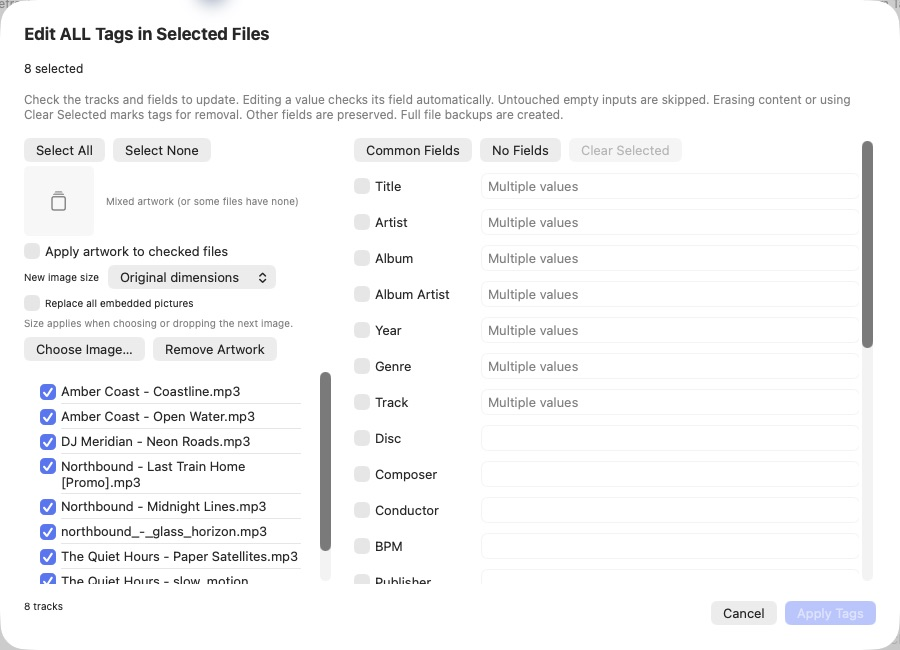
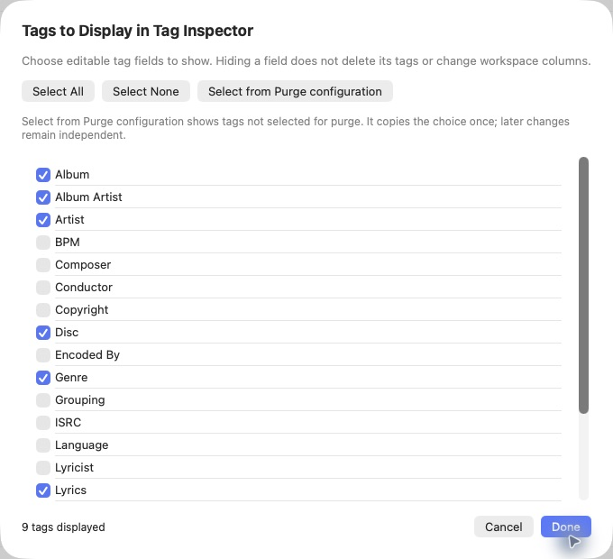
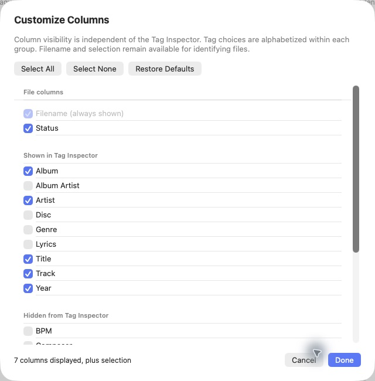

# TagCraft screenshot gallery

[Back to the README](README.md#screenshots)

Actual captures of **0.7.0 Beta (Build 1)** on **October 23, 2026**, using fictional artists and original sample artwork. The sample workspace contains eight files; the separate demo library contains 24 tracks. No changes were applied from preview or correction dialogs. The library-structure example is an unsaved draft, discarded after capture.

The [README](README.md#screenshots) shows the workspace, primary-library statistics and Library Health. Additional views are below.

## Edit ALL Tags

The full editor includes supported tags hidden from Tag Inspector. This example selects all eight demo files; differing values show Multiple values. No tag fields or artwork changes are checked, and nothing is applied.

## Tags to Display in Tag Inspector

Visibility is independent of column choices and tag removal. Select from Purge configuration copies a one-time inverse of configured purge fields. This dialog was canceled after capture.

## Customize Columns

Columns are grouped by whether their tags are shown in the inspector. Hidden inspector tags remain available as columns. Auto Fit Columns is in the workspace Columns menu and View; it does not change these visibility choices. This dialog was canceled after capture.

## Magic — review suggestions

Ambiguous interpretations remain excluded until reviewed. Suggested tags and filename changes are shown together.

## Health corrections

Corrections show current values and suggested replacements. This example shows the local naming-variation suggestion from Dj Meridian to DJ Meridian; nothing is checked or applied.

## Library structure

Album and individual-track placement are configured independently. This is an unsaved example with album folders and a custom Individual Tracks folder; Cancel discarded it after capture. Settings are committed only with Save.

## Move to Library preview

Move to Library previews the destination and offers a placement override for that operation. This separate example uses the saved direct-under-artist settings, not the discarded draft above. No file was moved.

